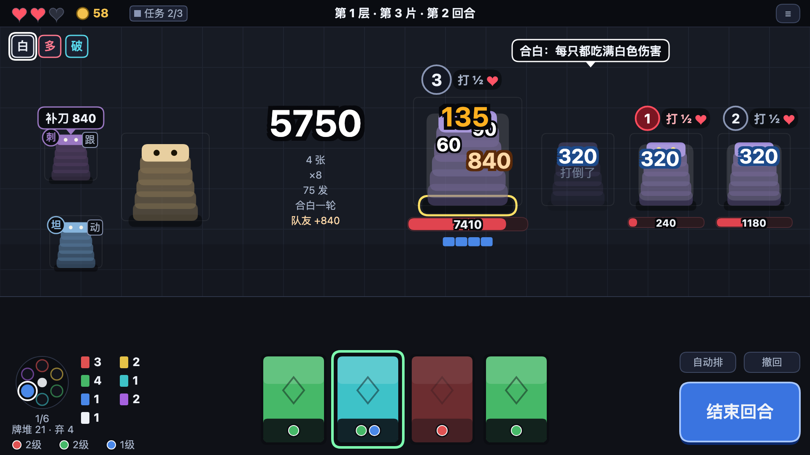
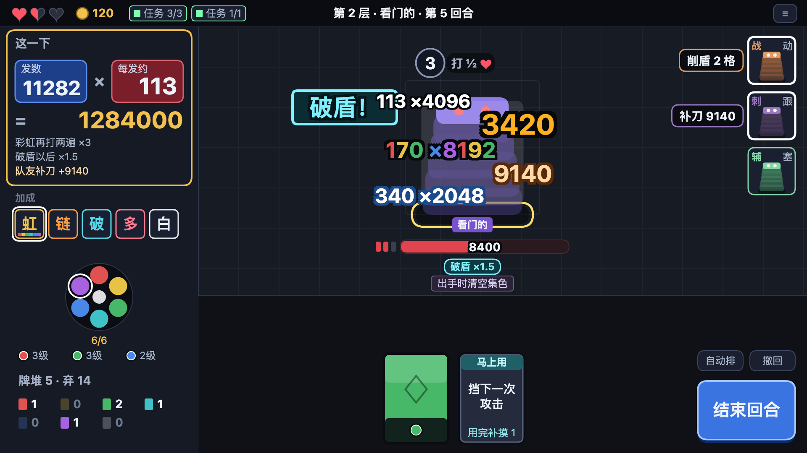
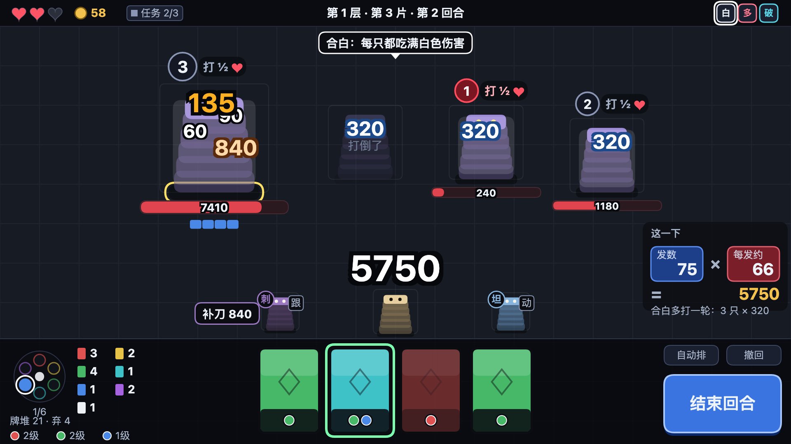
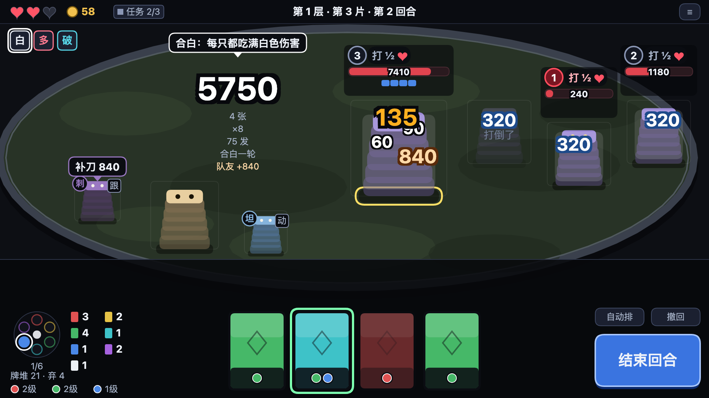

# 第二步：一起拿给用户挑（2026-11-23，claude）

A 画面框架、B 战斗布局、C 4 个加成和 2 个队友。每块给建议、理由、要拍板的问题和倾向。用户一样样挑，挑完再做第三步。

**截图**：`shots/布局候选/`。四个布局 × 四个场面，共 16 张，外加换窗口大小的。
**自己打开看**：`npm start`，浏览器开 `http://localhost:8000/modules/battle-view/proposals/?layout=1&scene=pack`。`layout` 填 1~4；`scene` 填 `chain`（一只怪，正在排链）、`pack`（一群 4 只，刚打出去）、`long`（看门的，排好 12 张还没打）、`gate`（同一下打出去，上万发）。拉窗口大小可以看缩放。

全是色块和假数据，还没接规则。怪、主角、队友画成一摞往上叠的色块，淡淡的方框就是以后像素堆叠立绘要占的位子。

---

## A　画面框架（整个游戏一套：探索、大厅、战斗都照它）

### A1　逻辑分辨率：不换，还是 960×540（16:9）

- 1920×1080 正好放大 2 倍，1280×720 是 1.33 倍。像素堆叠是运行时按任意倍率烘焙的（美术方案里「烘焙倍率跟屏幕缩放解耦」），不用凑整数倍；字按屏幕的像素密度画，放大也不糊。
- 考虑过 640×360（1080p 正好 3 倍，像素风常用）：中文最小字只剩 8 像素左右，看不清，不要。
- **窗口比例不一样**：整张画面等比缩放，多出来的地方留黑边。800×600 是上下留边，最小的 12 号字缩到 10 像素，还看得清（`窗口-800x600.png`）；1440×900 左右留窄边（`窗口-1440x900.png`）。以后可以把黑边换成把地面铺满，摆法不用改。

**拍板**：逻辑分辨率不换、比例不对就留黑边？**倾向：是。**

### A2　顶上一条状态栏（高 32，三种画面共用）

| 放什么 | 什么时候有 |
|---|---|
| 心 | 常驻 |
| 这趟带着的金币 | 常驻（大厅里换成手上的总金币） |
| 接的任务：一个任务一个小签「任务 2/3」，凑齐了变绿 | 常驻 |
| 在哪：「第 1 层 · 第 2 片」 | 常驻；战斗里后面接「· 第 3 回合」 |
| 菜单键 | 常驻 |
| 加成（一排小图标，悬停看全文） | 一趟里常驻。放状态栏还是放战斗画面里，看挑哪个布局 |

**只在战斗里有、放在战斗画面里，不进状态栏**：集色、宝石等级、牌堆里每色还剩几张、出牌的键。宝石等级虽然一趟里都在，但只有打仗时有用，探索时放进菜单里看。

**拍板**：状态栏这样分？**倾向：这样分。**

### A3　字号、间距、配色

- **字号五档**（逻辑像素）：12 小字（计数、小签）/ 14 正文 / 16 / 20 按键和小标题 / 28 大数；总伤害 44；飘字 22~36 看种类。最小 12，是为了 800×600 也有 10 像素。
- **间距**：按 4 的倍数排，块和块之间 8~12，跟屏幕边 12~16。
- **底色**：很深的蓝黑底；打仗的地面比底色亮一点，带淡格子（跟探索是同一片空地）。
- **牌面**（跟 neon 的不一样）：
  - 宝石牌整块是颜色，下面一条深色带放宝石点。宝石点永远落在深色上，蓝点在蓝牌上也看得清。宝石牌不写字，颜色就是它的名字，一眼数得出手里有几张绿。
  - 功能牌是深色牌面写功能；马上用的牌顶上一条青色写「马上用」；带颜色的功能牌用颜色描边。
  - 能接上的牌绿框、能合白的金框、会断的变暗。
- **飘字**（跟 neon 的不一样）：neon 按宝石的颜色给数字上色，红宝石的数跟暴击分不清。改成：
  - 普通一发：白字黑边；
  - 暴击：金橙色、加大；
  - 白色伤害（合白、白牌）：白字蓝边；
  - 彩虹再打的：一个字一个颜色；
  - 队友那一份：米橙色。
  - 发数多的打包显示「113 ×4096」（一包里每发多少、几发）。
- **破盾**：怪身上盖一个青色的「破盾！」字章，脚下的盾换成「破盾 ×1.5」小签。
- **危险**：倒计时剩 1 的那只，圆章变红。

**拍板**：照这套配色、字号、牌面？**倾向：照这套。**

---

## B　战斗布局：三个真不一样的

三个都用上面同一套框架和同一份假数据画。

### 布局一：左右对阵

- **摆法**：上面是场地，主角和队友站在左边，怪站在右边；中间一栏，排链时显示算式（发数 × 每发 = 多少），打出去以后换成总数和「大在哪」；链在场地和手牌之间横着一条；手牌在底下中间，左下是集色和牌堆，右下是打出键；加成一排挂在左上角。
- **好**：
  - 最像在打架：谁打谁一眼就知道，队友出手时头上冒一句「补刀 840」，跟数字一对就懂；
  - 「排链 → 打出 → 数字炸开」是一条从下往上、从左往右的路：链在下面排好，数字炸在右边的怪身上，总数亮在正中间；
  - 一群 4 只也摆得开；12 张的链能放下；
  - 主角、队友、怪都有固定的立绘位子，以后换像素堆叠直接放进去。
- **不好**：
  - 怪在右半边，不在正中间；
  - 4 只一起时，小怪只有九十多像素宽；
  - 链那一条比较窄，12 张时每张只有 40 像素宽。

### 布局二：算式栏

- **摆法**：左边一整栏讲「这一下怎么来的」：大号算式、加成、集色转盘、宝石等级、牌堆。右边是怪、链、手牌。不画主角，队友是右上角竖着一列小方块，出手时方块亮、旁边冒一句话。
- **好**：
  - 「看得懂」最强：发数、每发、总数都是大字，下面一行行写着彩虹、破盾、队友各加了多少；
  - 怪最大，在右边正中间；
  - 集色转盘大，彩虹还差几色一眼就看到；
  - 链那一条最宽。
- **不好**：
  - 像牌桌，不太像在打架；没有主角，队友只是小方块，出手的演出弱；
  - 数字炸在怪身上，总数却在左栏，打出去以后眼睛要往左看；
  - 左栏占了四分之一宽，探索画面用不上这一栏，战斗跟探索不太像同一个世界。

### 布局三：俯视战场

- **摆法**：就在探索的那片空地上打。怪在上面，主角在下面中间、队友站两边，排好的链悬在主角前面，手牌放在底下一条半透明的托盘里；算式在右边一小块，加成挂在状态栏右边。
- **好**：
  - 跟探索最连得上：碰到怪不换画面，就地开打（像哈迪斯）；
  - 怪在正中间；链从主角往怪那边排，打出去的方向最顺；
  - 像素堆叠的俯视立绘最好看的就是这个角度。
- **不好**：
  - 竖着太挤：怪只能画到 130 像素左右，主角和队友只有 50 像素上下；
  - 看门的带特性、破盾、12 张链、总数，全挤在中间一竖条里（`布局3-gate.png`）；
  - 队友的话只能往两边冒，3 个队友时会挤。

### 看了美术样片以后（补，2026-11-23）

用户让对照 `美术/教程-像素堆叠AI制作方案/` 里做好的几只（哥布林、飞龙、海妖、魔蛇、史莱姆、蝙蝠、鱼人、妖精）再看布局。样片有几个共同点，直接关系到布局：

1. **斜着往下看，不是正上方往下看**：压扁 0.6，怪是站着的、有身高。布局三画成正上方的格子地，角度不对。
2. **每只怪都站在一块圆台中间**，地面是它那种地方的花纹（营地土、熔岩石、水、青苔石……），边上一圈石沿。这块圆台就是现成的「战斗场地」，也正好是探索那片空地的一块。
3. **左下角都立着一个木桩当靶子**，怪的 4 个本事（丢炸弹、喷火、扑过去……）都是冲着它放的。所以战斗里**主角必须在场**，而且站在怪的斜前方，本事才有地方打。布局二不画主角，用不上这些演出。
4. **怪的形状差很多**：飞龙、魔蛇、蝙蝠是横着宽的，海妖、哥布林是竖着高的，会飞的离地悬着。怪的位子要宽一点，血条不能固定贴在脚下（宽的怪会盖住），要挂在头顶：美术方案里已经约好了挂点，头顶血条、盾、倒计时挂在 `headZ`，飘字挂在 `centerZ`。
5. **大小对得上**：样片按「屏幕高度大约 128 格体素」来放大，960×540 正好一格 4 像素多，一只哥布林一百像素上下，跟布局一里怪的大小差不多。A1 不用改。
6. **地面颜色很花**（绿青苔、红熔岩、蓝水）：飘字不按宝石颜色上色（A3）是对的，不然绿宝石的数落在青苔上看不见；头顶的血条、算式都要垫一块半透明的深色底。

所以三个布局都不完全合适：布局一的信息摆法对，但场地画成了平的、主角和怪平着排；布局三的角度方向对，但竖着放不下。**我照样片重画了一个布局四。**

### 布局四：斜看圆台（新）

- **摆法**：上面一块斜着看的椭圆地面（就是样片的圆台，近处的边被下面的托盘盖住）。主角和队友站左下（近处），怪站右上（远处），斜对角对着打，跟样片里木桩和怪的位置一样。血、盾、倒计时挂在怪头顶，垫一块深色底。中间偏左那块空地，排链时放算式，打出去以后放总数和「大在哪」。下面跟布局一一样：链一条、手牌、左下集色和牌堆、右下打出键。
- **好**：
  - 样片直接放得进去：圆台、地面花纹、斜看的角度、主角站的位置，全是现成的；
  - 怪的本事、队友的出手都有方向：从右上打到左下、从左下打到右上，演出最好排；
  - 探索走到怪跟前开打，镜头往前推一点，地面还是那片地面，不用换一个画面；
  - 一群 4 只排成远处一道弧，头顶的条错开高低，不挤（`布局4-pack.png`）；
  - 看门的 + 12 张链 + 3 个队友 + 5 个加成也放得下（`布局4-long.png`、`布局4-gate.png`）。
- **不好**：
  - 怪在右上，还是不在正中间（斜对角本来就这样）；
  - 头顶的条离状态栏很近，看门的那种四行的条，顶到状态栏下面了；
  - 主角那摞色块离近处的边很近，被托盘盖掉一点脚。

### 我的倾向：改成布局四

- 布局一的信息摆法（中间算式、下面链和手牌）留着，场地换成样片的斜看圆台，站位换成斜对角。
- 以后定的「镜头」：探索时离远一点（一格体素 3 像素左右，看得到整片空地），一开打镜头往前推到一格 4 像素，就是这张图的样子。

**拍板**：
- B1：挑哪个布局？**倾向：布局四（看了美术样片以后改的；原来倾向布局一）。**
- B2：主角和队友在战斗里出不出现？**倾向：出现**（布局四：主角在左下，队友站在主角两边；样片里木桩的位置）。
- B3：试玩工具（选仗、开关）收进调试面板：右上角的菜单键旁边加一个小按钮，或者按 `` ` `` 键弹出来，盖在画面上，不占地方。**倾向：按键和小按钮都要。**

---

## C　4 个加成、2 个队友

全只写功能，不取名。加成写成「时机 + 条件 + 动作 + 数」，现在的动作表里大多有现成的动作。

### 加成：四个位子，每个两三种

**位子一：破盾**

| | 干什么 | 喂哪条 | 打哪种顺手 |
|---|---|---|---|
| 1A | 破盾时，对所有怪打一轮白色伤害：红、绿、蓝各打「破盾那一刻的倍率」那么多发。不削盾 | 破盾 + 合白（横跨） | 双色盾、一群（厚的那只一破，小怪一起吃）、看门的 |
| 1B | 每条链里第一张对色的牌，每颗宝石多削 1 格 | 破盾 | 双色盾、看门的；「先排对色的牌」更值 |
| 1C | 破盾以后受到的伤害从 ×1.5 变成 ×2.25，但破盾不再推倒计时 | 破盾（更贪） | 血厚的；怕倒计时短的 |

倾向 **1A**：一下子炸一轮、打一群也有用，拿到它就是「破盾合白流」，正好是设计稿 6.1 举的例子。

**位子二：合白**

| | 干什么 | 喂哪条 | 打哪种顺手 |
|---|---|---|---|
| 2A | 合白多打的那一轮也削盾，每颗 1 格 | 合白 + 破盾（横跨） | 双色盾（一张补色牌削两色） |
| 2B | 合白不清空集到的颜色 | 合白 + 彩虹（横跨） | 一群、血厚的；要小心「集到几色就少受几成」的 |
| 2C | 合白多打的那一轮，再多打一轮 | 合白 | 一群 |

倾向 **2B**：把合白和彩虹之间最大的取舍拿掉，打法真会变（敢故意接补色了）。2A 跟 1A 都是破盾 × 合白，四个里重了。

**位子三：彩虹**

| | 干什么 | 喂哪条 | 打哪种顺手 |
|---|---|---|---|
| 3A | 彩虹再打的两遍变成三遍（×3 变 ×4） | 彩虹 | 血厚的 |
| 3B | 每回合开始，顺着当前色记上一种还没集到的颜色 | 彩虹 | 看门的（出手清空集色的那条）；怕「集到几色就少受几成」的 |
| 3C | 彩虹以后不从一色重新集，留下这一色和它两边，一共 3 色 | 彩虹 | 血厚的、看门的 |

倾向 **3C**：一仗里能接二连三地彩虹，节奏变了；3A 只是数变大，打法不变。

**位子四：长链还是留牌**（设计稿说原型先撑起前 5 条，前三个位子占了破盾、合白、彩虹）

| | 干什么 | 喂哪条 | 打哪种顺手 |
|---|---|---|---|
| 4A | 每条链第一次断色，照样 ×2 | 长链 | 遮住手牌的、每回合挑一色减半的；什么怪都用得上 |
| 4B | 回合结束手里留着牌，下回合的链从 ×2 起（最多算 1 张） | 留牌 + 长链（横跨） | 血厚的、看门的；怕倒计时短的 |

倾向 **4A**：设计稿第 11 节说「长链那条要加平时也能用上的」，这就是。留牌已经有「留 1 张不占名额」的开关在试。

**拍板**：四个位子各挑哪个？**倾向：1A、2B、3C、4A。**

### 队友：12 个候选里挑 2 个

下面挑了 6 个参与方式各不一样的，把设计稿里没写细的数补上了：

| 候选（设计稿 5.7） | 怎么参与 | 本事 | 补上的数 |
|---|---|---|---|
| 战士 A | 自己动（出牌前） | 每回合砍一刀，专削当前那条盾 | 每回合 1 格；双色盾削剩得多的那色；不打伤害 |
| 刺客 B | 跟着触发 | 破盾那一下，补一刀单独的大伤害 | 攻击 × 15，单独判暴击，吃破盾以后的 ×1.5；这一刀不再触发「打中一发时」 |
| 刺客 C | 跟着触发 | 每打中 N 发补一刀 | 每 30 发补一刀，一刀攻击 × 2；彩虹再打的也算发数；一条链里的合成一次演出 |
| 辅助 B | 塞牌 | 牌组里多几张他的牌 | 这一仗多 3 张现成的功能牌：2 张「记两边的颜色」、1 张「倍率 ×2」，牌上带他的记号 |
| 坦克 C | 跟着触发 | 每破一次盾，怪的倒计时多推一格 | 1 格；看门的那条「破盾倒计时 -1」也照样加（5.5） |
| 辅助 A | 后台加成 | 每仗第 1 回合多摸 2 张 | 2 张 |

倾向 **刺客 B + 辅助 B**：
- 参与方式不一样：一个跟着触发，一个塞牌；
- 刺客 B 给破盾加分量。检查记录第 5 条：现在「按破盾排」跟「按最长的链排」几乎没差，有它在，先破盾才真的赚；
- 辅助 B 塞的是现成的牌，正好试「塞牌」这种方式好不好玩，又喂彩虹和长链；
- 刺客那一刀在算式里单独一行「队友补刀 +多少」，最好演。
- 没挑坦克：假玩家打看门的已经掉心太少（检查记录第 6 条），再加防守的会更少。也没挑战士 A：每回合自动削盾，可能把「先破还是先打」的取舍削没了。

**拍板**：挑哪两个？**倾向：刺客 B + 辅助 B。**

---

## 挑完以后做什么（第三步）

- 布局：配色字号进 `modules/ui/` 的主题，区域表进 `modules/battle-view/layout.js`，照挑定的布局重做 `battle-view`；选仗台和开关收进调试面板；写 `设计/界面.md`。
- 加成和队友：写成数据放 `content/`，缺的动作补进 `shared` 的动作表和 `battle-rules`，每个都有单测；调试面板里能挑带哪些。
- 顺手要修的：一条链打出几十包以上时，`fx` 只留最后 36 包、还都带 0.45 秒延迟，打出去先空一下再一起冒出来。重做飘字时改成先冒前面几包、后面的合成大包。
